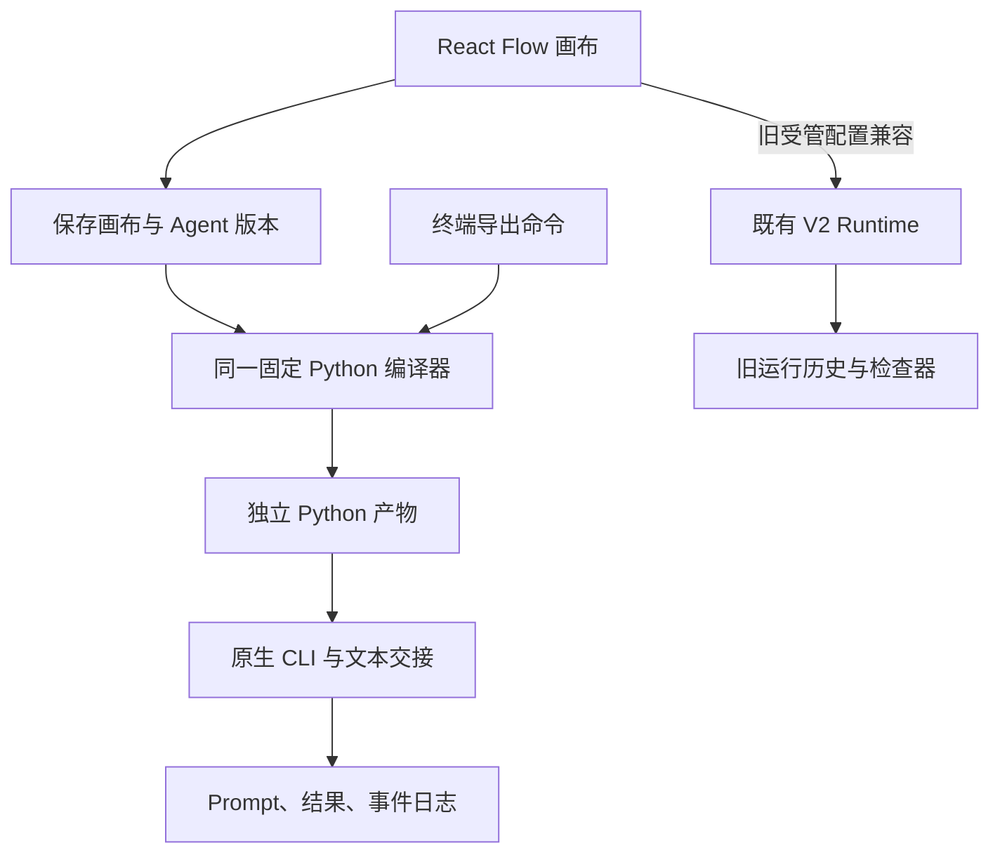

# Script-First：首批架构收敛与最小 Stable 边界

## 1. 目标与范围

DevFlower 负责 Agent 之间的任务调度与成果交接。画布由固定编译器生成独立 Python，
原生 CLI 自行使用 Tools、Skills、MCP 和子 Agent。编译不调用模型。

本批基线为 `218f0c3f7d50aea6f6da0434199b4c15c23e91f1`，其
[V2 CI 两项任务通过](https://github.com/Silver-Zhang/DevFlower/actions/runs/43229827324)。
仅修改 `v2/parity-integration`；不发布 Stable，不改 main/develop，不迁移或删除用户记录。
本批交付简化配置、同一编译器的 GUI 导出及脚本可靠性修复，不替换尚未真实验收的 GUI 运行器。

## 2. 做法与依赖证据

| 核心职责 | 实际模块 | 当前处理 |
|---|---|---|
| 画布编辑 | `ui/index.jsx`、`CanvasNodes.jsx`、`CanvasLinks.jsx`、React Flow | 保留节点、连线和保存行为 |
| 结构校验 | `documents.py`、`canvas_structure.py`、`ui/canvasModel.mjs` | 保存结构与脚本可执行能力分开检查 |
| Agent 存储 | `agent_records.py` → `records` 表 | 复用 ID、revision、幂等和工作区隔离 |
| 确定性编译 | `tools/devflower_export.py` | GUI/终端共用；只依赖 Python 标准库 |
| 原生调用及交接 | 内嵌 `tools/workflow_script_runtime.py` | 只依赖标准库、原生 `codex` / `claude` |
| 脚本运行证据 | 私有运行目录中的 Prompt、stdout、stderr、answer、result、events | 新执行路径的事实来源 |
| 旧 GUI 运行/展示 | `runtime.py` → `worker.py` → Scheduler；`run_inspector.py` | 兼容保留，尚未接管脚本日志 |



最终 GUI 的运行也应启动该 Python 产物并读取其日志；不再另写调度器。
目前图中旧运行分支仍在，不能称执行路径已经统一。

## 3. 决策与实际修改

### Agent 配置

新建默认显式保存 `execution: native-cli`，常用配置为名称、Provider、工作目录、角色、
任务 Prompt、输出与交接要求。模型、推理强度和超时可选，空值继承 CLI 默认配置或不设超时。
新合同没有工具权限、Skills 哈希、子 Agent 开关、Ask/Plan 模式、受管会话或命名 HOME 字段。
不探测这些内部能力，也不生成禁用能力或跳过原生保护的参数。

旧记录仍按原字段读取、编辑和运行。兼容表单仅在选择旧记录或明确选择“旧受管配置”时出现。
`freeze_agent` 在访问旧字段和预留运行意图前拒绝原生合同；旧修复/自动建队入口也明确拒绝。
因此，本批移除了新建核心路径对这些能力控制的依赖，未删掉旧执行器需要的安全检查。

### 同一编译产物

画布的“导出 Python（原生 CLI）”请求已保存的工作流 ID 和 revision。后端使用终端相同的
`read_saved` 和 `compile_workflow`，在同一 SQLite 查询事务内读取画布及匹配 Agent 版本。
版本过期、跨工作区、未显式选择原生合同、不支持节点或字段时拒绝导出。下载包含源码哈希，
浏览器若已编辑、切换工作区或改选草稿，则丢弃迟到的导出响应。导出不启动 CLI。

SQLite 使用“现有数据库 + query_only”事务：禁止业务写入，允许 SQLite 完成正常 WAL
辅助文件收尾。原来的 `mode=ro` 会遗留 `-wal/-shm`，使现有会话只读入口拒绝后续读取。
测试核对业务记录不变，并在静止数据库夹具中核对数据库字节和文件列表不变；不承诺并发
写入时 SQLite 的物理文件字节永远不变。

编译器版本提升为 2，明确拒绝未知节点/连线/配置字段和未知配置版本；保留显式为 false
等初始数据，执行 Start→Agent 的长度上限，不再静默忽略。超时必须可表示为有限正整数秒。

### 取消与失败

SIGINT/SIGTERM 只登记取消意图，避免子进程启动后、句柄返回前丢失清理机会。取消与超时
停止本次启动的进程组；组长退出不能代替整个组退出，抗 TERM 的残留子进程随后被清理。
非零退出和无法确认最终回答也清理本次进程组。取消记录 CANCELLED 和未知副作用，超时
记录 UNKNOWN，均保留 RUN_STOPPED、不自动重试、不调用下游。结果写入期间取消也不能
发布 RUN_COMPLETED。其他原生会话不受影响。

### 保留与移除的边界

| 模块 | 本批处理及删除前提 |
|---|---|
| 旧 Agent 内部能力表单/适配 | 退出新建核心路径，保留旧记录兼容；对应旧执行器退出后再删 |
| `runtime.py` / `worker.py` / Scheduler | 仍被 GUI 运行、恢复与历史读取使用；同脚本启动和日志读取接管后再退役 |
| `tools/studio/` | V2 还复用 Store、CLI 原语、UI 组件、theme 与依赖锁；不能整目录删除 |
| `assistant_*`、Git 平台/交付模块 | 不发展；仍有 server、UI、runtime 真实引用，需先解除入口和钩子 |
| 旧测试与用户数据 | 未删除；旧合同仍在使用，对应回归继续运行 |

## 4. 验证结果与限制

核心测试命令（V2 模块需要 Linux 提供 seal 常量的 Python；本地使用 `/usr/bin/python3`）：

```sh
PYTHONPATH=tools /usr/bin/python3 -B -m unittest discover -s tests -p 'test_native_workflow_export.py' -v
PYTHONPATH=tools /usr/bin/python3 -B -m unittest discover -s tests -p 'test_workflow_script_cancellation.py' -v
PYTHONPATH=tools /usr/bin/python3 -B -m unittest discover -s tests -p 'test_v2_native_agent_contract.py' -v
PYTHONPATH=tools /usr/bin/python3 -B -m unittest discover -s tests -p 'test_v2_script_export.py' -v
```

本批核心用例覆盖：确定性与独立执行、原生默认配置、精确交接、错误/超时/取消、进程组
隔离、GUI/终端脚本逐字节一致、版本冲突、数据库记录保持及新合同拒绝旧执行器。
其中本地子进程与模拟 CLI 仅证明传输和控制行为，不代表模型调用成功。
新测试已加入原有 V2 CI，旧测试继续保留。UI bundle 由既有锁定依赖构建。

本地最终代表回归 83 项全部通过：导出 25 项、取消 7 项、原生配置合同 9 项、GUI 导出
HTTP 5 项，以及旧 Agent、助手修复/提案、画布保存/结构 37 项。分工代码复核发现的
结果写入取消窗口和超大 timeout 溢出均已用反例修复并复核关闭。

浏览器用例已覆盖原生简化表单、保存/绑定、旧入口禁用、实际 Python 下载、仓库外 dry-run
及旧表单兼容。本地 Chromium 在启动前报 `socket() failed: Operation not permitted (1)`，
本地执行用例数为 0；动态结果以对应提交的 GitHub CI 为准，不能以静态构建代替。

真实 CLI 探测在本批开始时使用基线生成脚本执行一次：Codex 版本
`codex-cli 0.167.0-alpha.4`，认证状态为 ChatGPT 登录；实际命令为
`codex exec --output-last-message <run>/codex_probe/answer.txt -`，未覆盖模型或原生权限。
CLI 在模型回答之前退出 1：

```text
Error: failed to initialize in-process app-server client: Read-only file system (os error 30)
```

事件为 RUN_STARTED → CALL_INTENT → PROCESS_STARTED → CLI_FAILED → RUN_STOPPED，未自动重发。
当前环境没有 Claude executable、原生配置或认证环境。**真实 Codex→Claude 验收 BLOCKED**。
原始日志留在本地，不将账户文件、Prompt 全量输出或私有会话日志提交仓库。

## 5. 使用、过程记录与下一关口

1. 基线核验：远端 `218f0c3`、干净云端工作副本、无开放 PR；提交前再次核对远端 HEAD。
2. 依赖审查和首批实现：上述配置分流、同编译器导出、取消与输入合同修复。
3. 针对性自验与分工代码复核：与真实 CLI 验收分开记录，不冒充 Claude 独立审核。
4. 推送只允许快进更新 V2 集成分支；由对应提交 CI 验证完整回归，不自动发布。

在 GUI 保存简单顺序画布后，点击“导出 Python（原生 CLI）”。终端也可导出同一产物：

```sh
python3 tools/devflower_export.py --database /path/to/v2.sqlite \
  --workspace-id WORKSPACE_ID --draft-id DRAFT_ID \
  --output-dir /existing/export-directory --native-config
python3 /path/to/工作流_XXXXXXXX.py --workspace /path/to/project --dry-run
python3 /path/to/工作流_XXXXXXXX.py --workspace /path/to/project --task '完成开发并审核'
```

导出文件不覆盖现有同名产物。生成脚本可离开仓库执行，需 Python 3.11+ 及已配置的原生 CLI，
不需要后台、数据库、浏览器或模型 SDK。本批按 POSIX/Linux 验证。`--run-dir` 指定尚不存在
的私有日志目录；`--task-file` 可提供任务文本。每次执行为新运行，不暗中恢复或重发旧请求。

首个 Stable 的剩余关口：在实际可用环境完成 Codex Developer→Claude Reviewer；让 GUI
启动同一份产物、取消本次进程并展示脚本日志；再用外部终端重跑同一产物。之后才逐项加入
Condition、有界循环、并行与 Merge。现阶段不支持这些图，也不支持已有受管会话续聊、
命名 Profile 映射或结构化产物合同；编译器明确拒绝。不得据本批测试宣布最小 Stable 完成。
